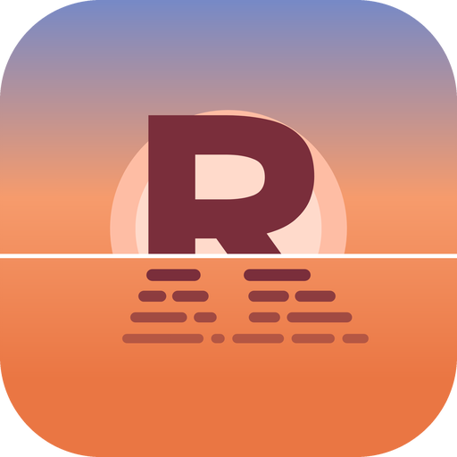

# Reach

Reach is an Android home screen that keeps your apps within thumb's reach, with widgets above and apps below.

> **Status:** early version, in closed testing on Google Play.

## Features

- **Three app layouts:** Normal (paged grid), Vertical (scrolling grid) and Text (a list of app names)
- **Widgets:** three sheets of widgets above your apps
- **Folders:** nested folders that you can resize and color
- **Pinned apps bar:** keep your favorite apps and folders one tap away
- **App search:** find apps quickly from the home screen
- **App shortcuts:** long-press an app to jump straight to its actions
- **Notification dots:** optional and off by default, shown in the phone's accent color
- **Custom look:** opacity, outlines, folder shape, light and dark themes, and system dynamic colors
- **Blur:** frosted glass surfaces on supported phones running Android 12 or later
- **Essentials mode:** no blur or animations, for speed and low memory use
- **Work profiles:** work apps appear alongside your own

## Requirements

Android 9 or later.

## Privacy

Reach has no internet access, ads or analytics. See the [privacy policy](PRIVACY.md).

## Contact

Questions and feedback: launcher.reach@gmail.com

---

Reach's source code is private. This repository holds its public information only.
